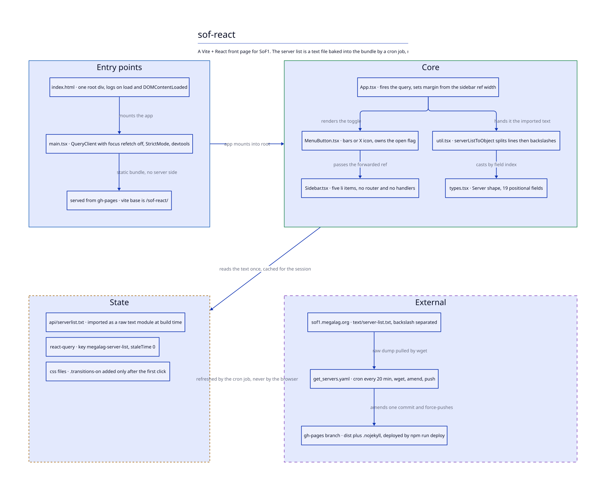

# sof-react

A Vite + React front page for SoF1 — a sticky collapsible sidebar and a server list parsed from a text file that is baked into the bundle, not fetched by the browser.

Read it left to right:

- **The server list is a compile-time constant, not an API call.** `App.tsx` does `import serverListText from './api/serverlist.txt'`, so Vite inlines the file into the JS bundle. The fetch you see in the query is `fetch(serverListText)` — it "downloads" a URL that is already inside the page. The browser never talks to `sof1.megalag.org`; the commented-out line above it is the live endpoint that was abandoned.
- **The data is refreshed by a GitHub Action, not by users.** `get_servers.yaml` runs every 20 minutes on the `gh-pages` branch, `wget`s `http://sof1.megalag.org/text/server-list.txt` into `api/serverlist.txt`, then `git commit --amend` + `git push -f`. Each run overwrites the previous commit, so gh-pages deliberately keeps a single-commit history — that force-push is the design, not a mistake.
- **The parser is positional, so upstream column order is a silent dependency.** `util.tsx` keeps its own hardcoded `FIELD_NAMES` list and assigns values by index after splitting lines on `\n` and fields on `\`. If megalag ever reorders or inserts a column, every field shifts into the wrong key with no error. The trailing newline in the file also produces one phantom `undefined:undefined` server.
- **Only the sidebar and the query exist.** `Sidebar.tsx` renders five `<li>` items with no router and no handlers; the readme's About / Maps / Skins pages, pagination and map previews are all still unbuilt. The parsed server list is logged to the console and never rendered.
- **The width animation is deliberately late.** `App` shifts its own `margin-left` to the sidebar's measured `offsetWidth`, but the `transitions-on` class is only added once `renderCounter > 0`, so the first paint snaps into place and only later toggles slide.

Diagram source: [`docs/system.d2`](docs/system.d2) · renderer: [`scripts/render-diagram.sh`](scripts/render-diagram.sh).
